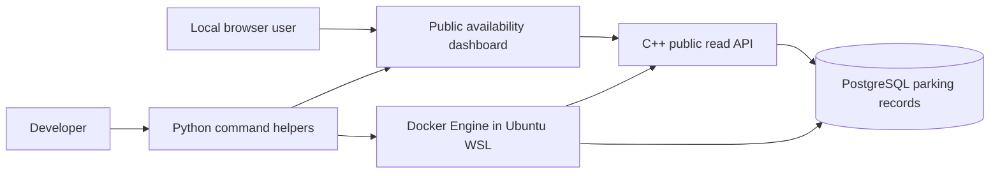
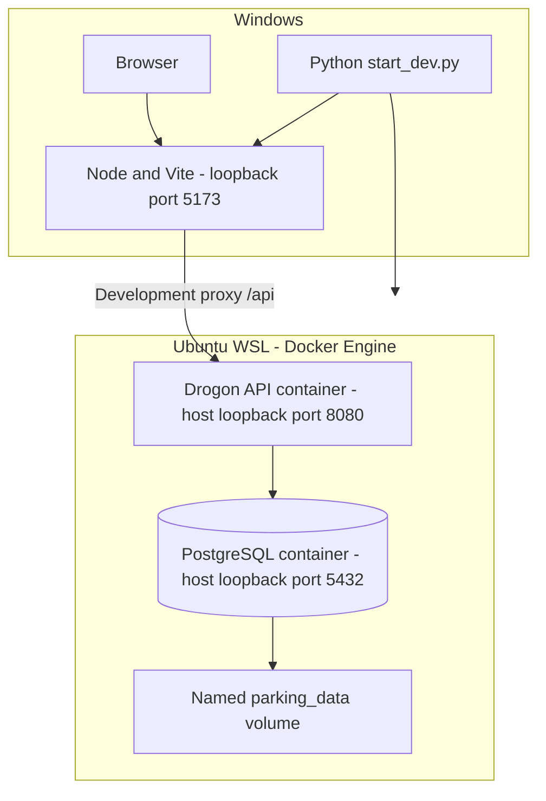
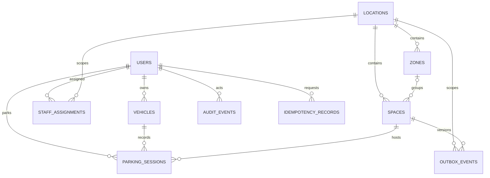

# Architecture and implementation status

Historical phase 1–2 reference. For the current implemented authentication and
transactional parking architecture, see [phases 3–4](PHASE_3_4.md).

## Scope

The application manages parking records for one operator with multiple locations.
Occupancy must eventually be confirmed by staff. Software cannot infer an
unreported physical arrival or departure. FoodService is a separate application;
this repository has no dependency on it.

AGENTS.md steps 1–2 cover inspection, scaffold, configuration, migrations and local
instructions. This checkpoint additionally includes an aggregate availability
endpoint and public dashboard. Steps 3–7 remain incomplete. Schema tables for a
feature do not establish that its application workflow exists.

## Current system context

## Current local containers and processes

Python keeps a foreground WSL process alive while the development launcher runs.
Keep that terminal open. Docker Desktop is not required by this setup. Docker
provides a repeatable Linux C++ build and database environment; it is not a parking
business requirement. A native Windows backend is an alternative, currently
unverified because the MSVC compiler installation is incomplete.

The frontend production build emits `dist/`. Vite is a development server.
Production static hosting, HTTPS ingress, secrets and deployment automation have
not been implemented or deployed.

## Source components

| Path | Responsibility |
| --- | --- |
| `index.html`, `frontend/style.css` | Accessible public layout, responsive styling, labeled sample bay |
| `frontend/main.ts` | Fetch/validate snapshot, filter locations, render safe text, errors and sample animation |
| `vite.config.ts` | Local proxy, fixed port, exclude large tool/build directories |
| `backend/src/main.cpp` | Configuration, DB pool, server startup, liveness/readiness |
| `backend/src/availability.cpp` | Aggregate SQL projection and JSON public response |
| `database/migrate.sql` | Transactional migration runner and ledger |
| `database/migrations/001_initial.sql` | Tables, references, indexes, checks, history trigger |
| `database/seed.sql` | Synthetic location and six spaces; no users or parking sessions |
| `scripts/parking_tools.py` | Node/pnpm discovery, subprocess calls, WSL/Docker access |
| `scripts/start_dev.py`, `scripts/test_system.py` | Local startup and explained test orchestration |
| `openapi.yaml` | Contract for the three implemented public GET endpoints |

## Data relationships

This diagram abbreviates references: session check-in/out actors also reference
users. Composite foreign keys enforce session vehicle ownership and a space's
zone/location relationship. Audit targets are polymorphic identifiers;
`outbox_events.aggregate_id` specifically references a space.

Implemented database invariants:

- One enabled vehicle per user and one enabled registration per jurisdiction.
- One active session per user, vehicle and space through partial unique indexes.
- Unique space label per location, bounded enum-like statuses/types and positive versions.
- UTC-capable timestamps; checkout cannot precede arrival and needs an actor.
- Session identity, arrival and registration snapshots are immutable. Completed
  checkout is immutable; deleting session history is rejected by a trigger.
- Referenced entities generally cannot be deleted while referenced.

These constraints do **not** authorize users, normalize registration input, prevent
every enabled/disabled transition, or implement a parking transaction. Consistent
locking, compatibility checks, active-session guards for replacement/maintenance,
audited writes and idempotency handling remain future application work.

## Current public API and consistency

| Endpoint | Behavior |
| --- | --- |
| `GET /api/health` | Process liveness; does not prove database availability |
| `GET /api/ready` | Checks database and migration 001 ledger; 503 when unavailable |
| `GET /api/locations` | Up to 100 locations with counts and server timestamp; 503 on DB failure |

Availability derives occupied spaces from sessions whose checkout is null.
Operational capacity excludes out-of-service spaces. Available plus occupied
equals operational capacity. Out-of-service is a separate count. No owner,
registration or per-space details are returned. Location pagination beyond the
current 100-row bound is not implemented.

The browser loads a snapshot on startup or manual refresh, with a five-second
timeout. Failed refresh retains the last successful snapshot and marks it stale.
This is **not realtime**: there is no SSE, automatic polling or measured two-second
delivery guarantee. The interactive bay changes only browser sample state.

## Architecture decisions

| Decision | Reason and consequence |
| --- | --- |
| TypeScript with Vite | Small typed frontend and fast local builds without a UI framework dependency |
| C++17 with Drogon | Owner explicitly requested C++ backend; framework provides HTTP, async PostgreSQL and JSON support |
| PostgreSQL | Transactions, foreign keys and partial unique indexes enforce shared parking invariants |
| Modular application | Keep one API process; separate domain/persistence/authorization/realtime modules as features grow |
| Docker Engine in WSL | Reproducible Linux toolchain without requiring Docker Desktop to run |
| Python standard library tooling | Owner requested Python launch/test commands; no Python package installation needed |
| Pinned dependencies | pnpm lockfile, framework commit, base-image digests and package inventories constrain changes |

Exact installed versions and package rationale are in
[TOOLS_AND_LIBRARIES.md](../TOOLS_AND_LIBRARIES.md). Package pinning is not proof
of vulnerability freedom. Debian repositories can retire pinned package versions;
such builds fail instead of silently substituting versions. Update pins deliberately.

## Future boundaries, not current components

Phase 3 introduces maintained authentication, recovery, role/location policy and
vehicle registration. Phase 4 introduces transactional parking services, safe
conflict handling and concurrency tests. Phase 5 adds authenticated driver/staff/
admin views. Phase 6 adds durable outbox delivery and authenticated SSE with replay.
Phase 7 adds operational hardening, CI/security/load verification and pilot evidence.

A future operator/tenant model must be designed and tested before onboarding
independent operators. Current tables do not provide tenant isolation. Payments,
reservations, cameras, sensors, gates and guest vehicles remain outside scope.
