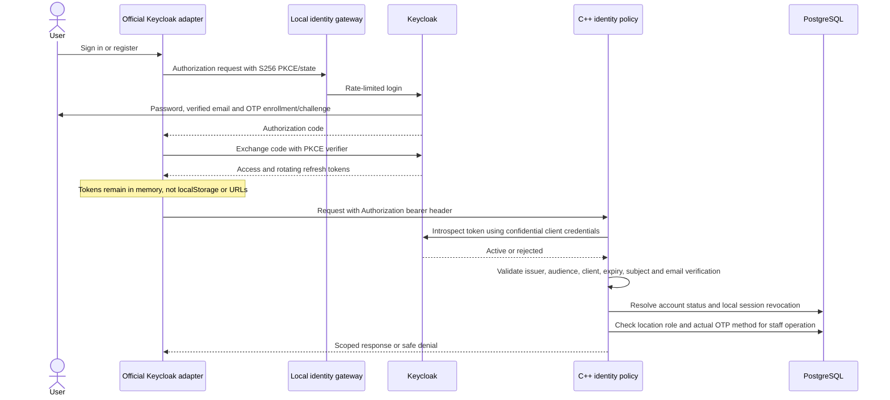

# Phases 3 and 4: identity and transactional parking

**Updated owner policy:** [retain test databases/records and inspect them](DATABASE_AND_EMAIL.md).
The runner now keeps per-case schemas and unique provider realms. Earlier disposable
cleanup/timing descriptions below document the prior implementation, not current behavior.
Real SMTP setup is pending the owner's privately entered Gmail app password.

This is the current implementation reference. The other architecture/design
documents describe the earlier phase 1–2 checkpoint where labeled as historical.
The project remains independent from FoodService, with one operator and multiple
locations. Tenant isolation, complete staff/admin pages, realtime delivery and
production launch work remain later phases.

## Implemented boundaries

| Module | Responsibility |
| --- | --- |
| Keycloak realm | Registration, verified email, password recovery, required OTP, password storage, expiry, refresh rotation and provider logout |
| Official `keycloak-js` adapter | Authorization-code login with S256 PKCE; access/refresh tokens stay in memory |
| Nginx identity gateway | Local identity entry point; login/recovery request bounds; no action-URL access logging |
| `identity.cpp` | Per-request provider introspection, issuer/audience/client/expiry/verification checks, account status, local revocation and staff MFA/location policy |
| `storage.cpp`, `storage.h` | Parameterized libpq statements, transaction RAII/rollback, validated JSON/UUIDs, SHA-256 request hashes |
| `parking.cpp` | Own vehicle/history, atomic check-in/out, idempotency, maintenance and scoped staff assignments |
| `protected_api.cpp` | Routes, bounded worker queue, safe error mapping and request IDs |
| Migration 002 | Identity profile fields, local session revocation and canonical registration checks |
| Local Mailpit | Captures verification/recovery email on this computer; never delivers externally |

Keycloak 26.8.1 and its official adapter 26.2.4 replace the need to implement
password authentication or cryptography inside this application. Existing
OpenSSL supplies SHA-256 and libpq supplies PostgreSQL access; neither is a new
custom authentication scheme. Psycopg 3.3.6 is a test-only multi-connection driver.
All new package/image versions are pinned, including image digests.

References: [Keycloak browser adapter](https://www.keycloak.org/securing-apps/javascript-adapter),
[server and adapter release versions](https://www.keycloak.org/downloads),
[token introspection](https://www.keycloak.org/securing-apps/oidc-layers),
[provider administration](https://www.keycloak.org/docs/26.8.1/server_admin/index.html).

## Local setup and testing

Prerequisites remain Python, Node/pnpm or the bundled runtime, Ubuntu WSL with
Docker Engine, and the configured local `.env` database values. Docker Desktop is
not used. Run in the parking directory:

```powershell
py scripts/setup_auth.py
py scripts/pnpm.py install --frozen-lockfile
py scripts/docker_wsl.py compose up -d db identity-gateway mail
py scripts/configure_identity.py
py scripts/docker_wsl.py compose exec -T db sh -c 'psql -X -v ON_ERROR_STOP=1 -U "$POSTGRES_USER" -d "$POSTGRES_DB" -f /workspace/database/migrate.sql'
py scripts/docker_wsl.py compose build api
py scripts/start_dev.py
```

Keep the last command's terminal open. It keeps WSL alive as well as running Vite.
The configuration command waits for the identity service. On an existing realm it
updates the two application clients and installs/binds the password-only recovery
flow, preserving accounts and credentials. Other realm flow/policy changes on an
existing installation need a separately reviewed provider migration; importing a
realm at startup does not overwrite it.

Open the website at `http://127.0.0.1:5173`. The account section offers provider
sign-in/registration and a real own-vehicle form. Register an email, open local
captured verification mail at `http://127.0.0.1:8025`, and enroll an authenticator
app when prompted. All users use OTP in the supplied local realm, which also
enforces the privileged-role MFA requirement. Forgot-password email is captured
in the same local mailbox. Password recovery preserves the enrolled OTP factor;
losing that factor requires reviewed provider-administrator support, not an email
link that silently removes MFA. This mailbox and bootstrap admin are development-only.

The initial identity-admin password is randomly generated in ignored `.env`,
never a default password. Provider administration is at `http://127.0.0.1:8180`.
Use the local credentials privately; do not paste them into issues or screenshots.
There is no automatically privileged parking user. After verified sign-in, use
the user UUID returned by `/api/me` and a location UUID from public availability:

```powershell
py scripts/bootstrap_admin.py --user-id YOUR_USER_UUID --location-id YOUR_LOCATION_UUID
```

This command is an explicit database-owner bootstrap, requiring trusted local
machine/database access. Subsequent assignments use the location-authorized admin
API. An attendant cannot grant roles. Operator admins can grant/remove attendant
or operator-admin permissions only at locations where they are admins.

In a second terminal, while local services are available:

```powershell
py -m pip install --target .tools/test-python -r requirements-test.txt
py scripts/test_phase34.py
py scripts/test_system.py
```

The first suite creates a temporary PostgreSQL container on port 15432, a test API
on port 18080 and a `parking-tests` provider realm. It removes those named test
containers and the test realm afterward, including on failures. It never truncates
the development database. The local identity gateway is briefly restarted to reset
its in-memory test rate quotas before and after tests; provider sessions remain intact. Synthetic mail
can remain visible in the local capture inbox. Tests need local ports 15432/18080
free, and temporarily reserve the `parking-tests` realm name.

## Authentication sequence



The API decodes claims only after successful provider introspection of that exact
token. It does not trust unsigned client claims or role/actor fields in a body.
The application uses explicit bearer authentication, not ambient cookies. Therefore
its writes do not authenticate cross-site cookie requests; an explicit allowed
Origin is also enforced. The provider manages its own login cookies and state.
Protected responses are no-store and carry `X-Request-ID`.

Every enabled verified account has driver capabilities for its own vehicle/session.
Staff privileges are additional database assignments, never self-selected roles.

Logout records the provider session ID as revoked locally, and the browser then
logs out at the provider. Every request checks revocation; disabling an account or
removing an assignment affects subsequent protected operations. Session inactivity
is 30 minutes and maximum lifetime 12 hours; access tokens last five minutes.
Provider failure fails closed. No token is accepted from a URL or application cookie.

The gateway limits login actions/token requests to 120/minute/IP with an 80-request
burst, and reset-credential requests to 5/minute/IP with a five-request burst.
Keycloak also enables per-account brute-force controls. These are local defaults,
not a measured production abuse-control/load policy.

## Parking transaction and lock order

```mermaid
sequenceDiagram
  actor Staff
  participant API as Parking service
  participant DB as PostgreSQL
  Staff->>API: Check-in or checkout with Idempotency-Key
  API->>API: Authenticate and validate request
  API->>DB: BEGIN
  API->>DB: Transaction advisory lock for actor, operation and key
  API->>DB: Read stored idempotency request hash/result
  alt Different request with reused key
    API->>DB: ROLLBACK
    API-->>Staff: 409
  else Matching retry or new key
    API->>DB: Lock actor and owner users sorted by UUID
    API->>DB: Lock vehicle, then space
    API->>DB: Shared-lock location assignment; require role and MFA
    alt Exact retry
      API->>DB: COMMIT without another parking mutation
      API-->>Staff: Original status and body
    else New valid action
      API->>DB: Lock session if checkout
      API->>DB: Insert session or set checkout exactly once
      API->>DB: Increment space version; insert audit and outbox
      API->>DB: Insert request hash and original result
      API->>DB: COMMIT
      API-->>Staff: Confirmed result
    end
  end
```

Vehicle replacement takes the same user/vehicle locks and rejects active sessions.
Maintenance locks the actor and space, requires location-admin access plus a reason,
and rejects an occupied space. PostgreSQL partial unique indexes remain the final
backstop even when application checks race. Uniqueness conflicts become safe HTTP
409 responses. Any failure rolls back the session, audit, outbox, version and
idempotency result together. Same actor/operation/key retries return the original
status/body; different canonical request content returns conflict. Stored records
have an expiry timestamp but are retained until a future retention job, so retries
remain safe for at least 24 hours rather than being silently reused after expiry.

Outbox records are **pending**, not published. Durable delivery/retries/SSE are
phase 6. There is no in-process broadcast that could expose uncommitted state.

Registration is trimmed, whitespace/hyphens removed and uppercased using PostgreSQL
`normalize_registration`; jurisdiction is trimmed and uppercased. Other characters
are preserved, with no country-specific plate pattern. Unicode equivalence and
jurisdiction-specific rules require explicit operator policy before launch.

## API scope

The canonical [OpenAPI contract](../openapi.yaml) is JSON-formatted YAML. It includes
public configuration/availability and protected own identity/vehicle/session/history,
staff space reads/check-in/out, location staff assignment and space maintenance.
Own history pages contain up to 50 records with bounded offset. Staff detail reads
are audited and bounded to 500 spaces. All IDs are validated; body fields are
allowlisted; SQL inputs are parameterized. Owners and registrations never appear
in the public aggregate response.

## Verification interpretation and remaining work

Executed on 2026-10-14 with Windows Python 3.14, Node 24, Ubuntu WSL Docker,
PostgreSQL 17 and Keycloak 26.8.1:

| Check | Result |
| --- | --- |
| `py scripts/docker_wsl.py compose build api` | PASS; C++ sources compiled and linked, pinned package inventories matched |
| `py scripts/test_phase34.py` | PASS; 28 tests, final harness run 9.850 seconds |
| `py scripts/test_system.py` | PASS; all six groups, including TS/build, 3 scaffold checks, 2 API checks, SQL constraints and 4 launcher regressions |
| Identity gateway `nginx -t` | PASS |
| Source credential check | PASS; actual local database/provider secrets absent from non-ignored source files |

Integration responses are checked against the declared OpenAPI response keys,
basic types/enums and protected response headers. This is targeted contract
verification, not an exhaustive OpenAPI validator or security certification.
The test runner requires a unique disposable-database guard before any fixture
truncation. Test containers and the test realm were removed after the passing run.
No prerequisite was missing for this selected WSL route. Optional native Windows
C++ verification still requires the previously missing MSVC Build Tools.

Concurrency tests use synchronized Python threads and separate HTTP/DB connections.
They assert one winner for one space, one user/vehicle in two spaces, and two distinct
vehicles belonging to one user at the database layer. The latter intentionally uses
a disabled historical vehicle to test the user partial index independently; the
API separately rejects disabled vehicles. A test-only DB trigger forces failure
after a session insert and proves complete rollback and successful retry.

Additional tests cover same-key concurrency, changed-body conflicts, duplicate
checkout, timeout retries, replacement/maintenance races, location/role denial,
role revocation, actual-MFA enforcement, provider/local logout, verified email and
single-use account recovery. See the result record in the README for executed runs.

Full staff/admin/driver dashboards remain phase 5; the public sample animation is
still a mock and never writes parking data. Phase 6 adds durable realtime. Phase 7
adds production HTTPS, production Keycloak/database/SMTP setup, least-privilege
service accounts, audit protection/retention, operational metrics, security and
load review, restore drills and pilot acceptance. Current identity runs development
mode with a local persistent H2 volume; it is not the production identity deployment.
The provider's temporary local bootstrap-admin credential must be replaced/revoked
and provider administration protected with MFA before production use. This local
bootstrap exception does not weaken the application staff/admin MFA checks.
No deployment, external email delivery, purchase or commercial readiness claim is made.
