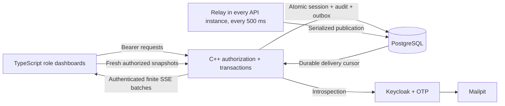
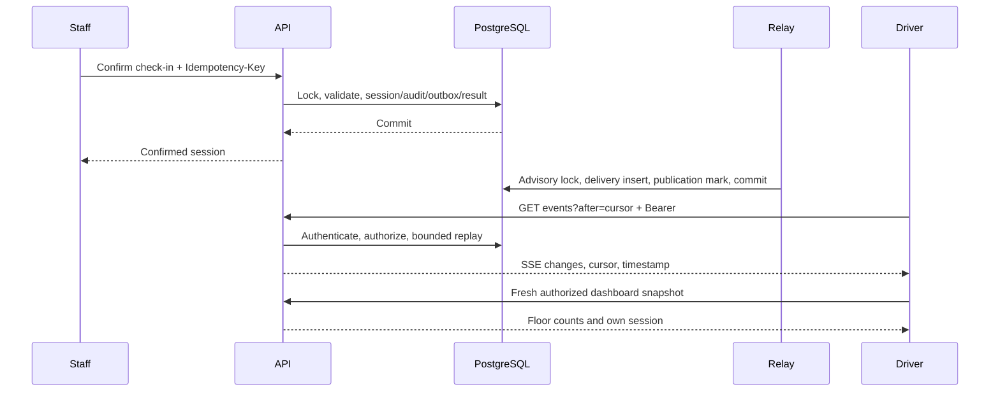

# Phase 5–6: dashboards and durable updates

This is the current reference, superseding older statements that staff controls
and realtime delivery are absent. One operator, multiple locations; hardware is
phase 8. No deployment is performed.

## Run locally

For a new checkout, first complete identity setup in [PHASE_3_4.md](PHASE_3_4.md).
For an existing installation, apply the additive migration and rebuild:

```powershell
py scripts/docker_wsl.py compose up -d db identity identity-gateway mail
py scripts/docker_wsl.py compose exec -T db sh -c 'psql -X -v ON_ERROR_STOP=1 -U "$POSTGRES_USER" -d "$POSTGRES_DB" -f /workspace/database/migrate.sql'
py scripts/docker_wsl.py compose build api
py scripts/docker_wsl.py compose up -d api
py scripts/start_dev.py
```

Open http://127.0.0.1:5173. If this application already occupies that port, refresh
the existing page. The seed is one Ground zone and six spaces; additional floors
are created by an administrator, never invented by the UI. Register, verify email
in http://127.0.0.1:8025 and enroll an authenticator. Mailpit is the owner's current
choice: real recipient addresses are accepted, but email is captured locally.

## UI and initial administrator

The UI now separates roles into focused sidebar screens. Read the
[role UI and manual walkthrough](ROLE_UI_GUIDE.md). **Switch workspace** replaces
the old Dashboard role dropdown; the public demo is hidden after sign-in. Staff
use separate check-in and check-out screens. Administration has separate location,
floor/space, user/staff and audit screens instead of one combined long page.

- Driver: vehicle dialog, location selection, floor counts, own current location,
  floor, space, arrival, elapsed minutes and paginated history. Other identities
  are never sent to drivers.
- Staff: assigned-location space grid, floor filter and search of the current
  100-space page. Cards show empty/occupied/out-of-service text, compatible type,
  authorized vehicle/owner details and arrival. Exact jurisdiction/plate lookup
  finds a registered enabled vehicle. Select a compatible empty space on the
  current page and confirm physical arrival. Confirm departure to check out.
  Success is shown after the server confirms; uncertain retries reuse the same key.
- Administrator: create locations, add/rename floors, add/edit spaces and vehicle
  compatibility, maintenance status, staff assignments, exact-email user/vehicle
  lookup, account status, vehicle disable and paginated audit search. Reasons are
  audited. Occupied spaces/active users cannot be changed destructively. Account
  status is operator-wide in this single-operator product. Vehicle replacement
  remains in the driver's verified account flow.

New accounts start as drivers. For the first **local development** administrator,
the owner runs this after registration, email verification, OTP enrollment and
one login to the parking application:

```powershell
py scripts/grant_local_admin.py --email YOUR_REGISTERED_EMAIL
```

The default is the seeded location. Add `--location LOCATION_UUID` for another
existing location. The command verifies the Keycloak account and records an audit
event. It creates no default password and bypasses no MFA. Refresh the page, choose
Administrator dashboard, and assign further staff there. This database-owner
bootstrap is not production onboarding.

## Architecture and design



Migration 003 adds `delivery_events`. Each API process retries publication every
500 ms. A transaction advisory lock serializes delivery cursor assignment across
instances. Delivery insertion and the outbox `published_at` update commit together;
a unique outbox reference prevents duplicate publication. Publication failure
rolls back and retries without undoing an already committed parking transaction.

Outbox sequence IDs alone are unsafe replay cursors: a lower allocated ID can
commit after a higher ID. Separate serialized delivery IDs prevent losing that
late commit. No in-memory emitter is used. A repeatable-read snapshot includes its
visible delivery cursor and occupancy; replay after that cursor covers changes
between snapshot and subscription.



SSE uses **finite batches**, not indefinitely open sockets: `text/event-stream`,
`event: changes`, `id`, `retry: 1000`, JSON changes/cursor/server timestamp, then close.
The fetch client reconnects after one second with a bearer header; tokens never
appear in URLs. Every batch rechecks expiry/revocation, account status and location
assignment. Logout aborts requests and clears private panels. There is no retained
privileged socket after permission revocation. Replay covers the newest 1000
location events, 100 per response. Old/future cursors force a fresh snapshot.
The replay limit does not delete retained records.

Events contain IDs, resource versions and timestamps only, even for staff. Driver
notifications identify the location and its delivery revision, not individual
spaces belonging to other drivers. Staff notifications identify assigned spaces. Plates,
owner details and contacts are fetched only through authorized snapshot APIs.
The client ignores duplicate/older delivery IDs and resource versions. Disconnects
show stale state, back off to at most 15 seconds, and use a 15-second snapshot
fallback. Anonymous overview counts poll every 15 seconds and stay labeled as
snapshots. More requests than persistent SSE is a deliberate tradeoff; identity,
worker and database capacity must be measured under staging load in phase 7.

## Tests

Keep the frontend running on 5173. In a second terminal:

```powershell
py -m pip install --target .tools/test-python -r requirements-test.txt
py scripts/setup_browser_tests.py
py scripts/pnpm.py build
py scripts/pnpm.py test
py scripts/test_phase34.py
py -m unittest discover -s tests -p test_retained_tools.py -v
```

The existing runner now tests phases 3–6. Run one suite at a time. Separate
persistent schemas and unique identity realms retain committed fixtures. Two API
instances run on 18080/18081. Synthetic mail always stays in Mailpit. Inspect the
database with `py scripts/view_database.py --start`. `--test-name test_36` runs the
browser journey alone. Its browser `/api` proxy forwards to real isolated APIs;
no API, occupancy, login or OTP responses are mocked. Independent browser contexts
exercise driver/staff/admin. The disconnect test aborts forwarding too, because
Playwright's out-of-browser proxy does not inherit Chromium's offline setting.
Synthetic screenshots stay ignored in `.tools/browser-results/RUN_ID/`.

Tests cover cross-location authorization, floor privacy, admin validation, replay,
two instances, late commits, relay failure/retry, rollback, restart, cursor reset,
duplicate/out-of-order versions, driver/staff check-in/out, history, admin floor
creation, keyboard dialog dismissal, labeled forms and mobile viewport overflow.
Full independent accessibility and real mobile-browser coverage remain launch
verification tasks; emulation does not establish device compatibility.

## Packages and remaining work

Verified locally on 2026-10-15 (Windows Python 3.14, Chromium 153, Ubuntu WSL Docker,
PostgreSQL 17, two C++ API instances):

- C++ image build, TypeScript check and production Vite build passed.
- 5 frontend/source/replay checks passed.
- Complete phases 3–6 suite: **37 passed in 161.157 seconds**.
- Retained-tools safety suite: **8 passed in 0.559 seconds**, run after the full
  suite because its lock test intentionally rejects a concurrently active suite.
- System runner: all 6 groups passed, including 2 API checks, SQL invariant
  transactions and 4 Python launcher checks.
- Last full run measured 0.068 seconds from check-in request to peer replay, and
  0.342 seconds from browser confirmation to driver display. These are local
  samples, not staging/load guarantees.
- Retained run ID: `5a865933-d03f-4475-900e-b038a728b43f`; identity realm
  `parking-tests-5a865933d03f`. Case schemas, identities and committed records remain.
  Browser screenshots are in `.tools/browser-results/5a865933-d03f-4475-900e-b038a728b43f/`.
- Desktop staff/admin and mobile driver screenshots were visually inspected;
  Chromium also checked keyboard dialog dismissal and mobile overflow. This is
  limited accessibility evidence, not a comprehensive accessibility audit.

No runtime framework or broker was added. Existing pinned Drogon/libpq and
PostgreSQL provide transactions and shared durable delivery. Native `dialog`
provides keyboard dismissal/focus containment; existing `keycloak-js` handles auth.
[Playwright 1.63.0](https://pypi.org/project/playwright/1.63.0/) and its dependencies
are pinned in `requirements-browser.txt` for reproducible Chromium testing.

Phase 7 remains: production setup, security/load/restore evidence, observability,
CI, operational runbooks, privacy policy and pilot acceptance. Local latency is
not a staging SLA. Phase 8 remains the planned ANPR/RFID/sensor/barrier integration.
Payments, reservations, guest vehicles and independent tenant isolation are absent.
