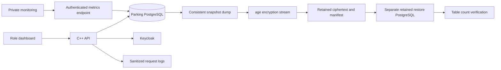

# Phase 7 — operations and launch verification

Status: local operational tooling implemented; commercial launch acceptance remains pending.
Latest local account workflow uses email/password without OTP, staff signup requests
approved afterward by administrators, and staff-created driver accounts/vehicles.
See `ROLE_UI_GUIDE.md`. Migration 005 is required in addition to operational migration
004. Production MFA and security acceptance remain pending launch requirements.
This independent VehicleParkingSystem retains the C++ API, TypeScript UI and PostgreSQL.
No deployment, service purchase or external email was performed.

## Owner decisions

Country: **India**, confirmed by the owner on 15 October 2026. Operating state,
alert owner, incident owner, availability and RTO/RPO targets remain unspecified.
The owner confirmed **500 concurrent users** as the main load-test target.
The measured three-user run remains a preliminary public-read baseline;
the 500-client local public-read scenario has now run, as recorded below.
The local load helper supports up to 500 synchronized virtual clients and records
peak in-flight requests. Staging traffic mix, duration, response-time/error
thresholds and recovery criteria still need agreement.
`operations/launch-gates.json` is the visible acceptance record; false/null means pending.

## Exact local commands

Run from `C:\Users\Pankil\Documents\ChatGPT\Parking_System` with Python 3.14,
Ubuntu WSL Docker Engine running and the existing local setup complete:

```text
py scripts/setup_auth.py
py scripts/setup_ops.py
py scripts/docker_wsl.py compose build api
py scripts/docker_wsl.py compose exec -T db sh -c 'psql -X -v ON_ERROR_STOP=1 -U "$POSTGRES_USER" -d "$POSTGRES_DB" -f /workspace/database/migrate.sql'
py scripts/docker_wsl.py compose up -d api
py -m unittest discover -s tests -p test_operations.py -v
py scripts/monitor.py
py scripts/load_test.py --concurrency 3 --seconds 10
py scripts/load_test.py --concurrency 500 --seconds 30
py scripts/backup_database.py --drill
py scripts/test_system.py
py scripts/test_phase34.py
py scripts/scan_dependencies.py
py scripts/package_release.py
py scripts/launch_check.py
```

Keep `py scripts/start_dev.py` running in another terminal for website/browser tests.
`launch_check.py` deliberately returns exit code 1 while acceptance is pending.
Dependency scanning also fails on high/critical API image findings, any pnpm audit
findings, or scanner failures. Read the retained report before interpreting an exit code.

## Implemented operations

- `/api/health` and migration-aware `/api/ready`; version 004 adds retained client heartbeat records.
- Authenticated `/internal/metrics` with an independent randomly generated metrics
  credential. No user identities, contact details, registration numbers or bearer
  tokens appear in metric labels. Fixed route groups bound cardinality.
- HTTP latency histogram, request/error/authentication/conflict counters, outbox
  backlog/lag, database connection pressure and recent/stale dashboard clients.
  SSE is finite batches: these are heartbeat estimates, not exact open socket counts.
  Identity-provider failed-login metrics and error-tracking service integration remain pending.
- Structured HTTP logs contain request ID, route group, status and duration only.
  Monitoring thresholds are provisional. `monitor.py` prints local alerts;
  Prometheus examples are provided but no monitoring service is installed or contacted.
- Configuration supports `API_DATABASE_URL_FILE`, `OIDC_CLIENT_SECRET_FILE` and
  `OPS_METRICS_TOKEN_FILE`; file values take precedence. Production mode rejects
  non-HTTPS application origin/issuer. This guard does not supply a TLS proxy.
- Loopback default API binding; Docker explicitly binds inside its private network
  and publishes only on host loopback. Native launcher imports complete auth config;
  `py scripts/run_native.py --check-only` checks config, not an MSVC build.
- Pinned age 1.3.2 supplies established backup encryption; pinned Grype 0.120.1
  scans images. Installer verifies official release archive SHA-256 values in
  `operations/tools.lock.json`; no bespoke encryption implementation.
- PostgreSQL custom-format dumps use an exported consistent snapshot and stream
  directly into age. No plaintext dump file is created. Restore checks ciphertext
  hash, restores into a fresh database on a separate persistent PostgreSQL container,
  and verifies table counts from the same snapshot. All backups/databases remain.
  **This does not back up or restore Keycloak's development H2 identity database.**
- Review bundles contain built frontend, API image archive, migrations, image ID,
  SHA-256 file manifest and acceptance gates. Dirty builds get a distinct working
  version; they are not represented as clean commit builds. Nothing is pushed.

## Least-privilege account

```text
py scripts/setup_runtime_db.py
py scripts/check_runtime_db.py
```

Run setup once; it refuses to overwrite existing credentials. It creates an independent
runtime login and ignored `.tools/secrets/runtime-database-url`. Verification proves
reads work and audit UPDATE/DELETE and schema creation are denied. Owner credentials
remain for migrations. Optional local switching command:

```text
py scripts/docker_wsl.py compose -f compose.yaml -f compose.runtime.yaml up -d api
```

The optional override mounts the private DSN as a file. Full business flows under this
separate login need verification before production adoption. New migration tables
require explicit grants. Local key/secret files rely on the owner's Windows profile
ACL; production must use reviewed secret-manager access and separate backup keys.

## CI

`.github/workflows/verify.yml` provides manual verification on a dedicated persistent
Linux runner labelled `parking-ci`; it is not connected to a runner yet and has not
run in GitHub. Action revisions are immutable. `ci_verify.py` builds/typechecks,
runs unit/API/database/browser checks, reapplies migrations, verifies operations,
performs an encrypted restore drill and scans dependencies. It performs no deployment
or database cleanup. Configure a dedicated test host with Docker Compose, browser
system libraries and outbound package access. Do not use a production host.
Automatic branch/PR triggers, a dedicated lint configuration, secret scanner,
runner access review and retained identity recovery are still required CI work.

## Launch work still pending

Production TLS/domain/reverse proxy and validated configuration; separate PostgreSQL
identity persistence; production secret manager and backup key custody; off-host
encrypted backup and full application/identity restore; staging deployment/rollback
and migration compatibility; agreed load/failure-recovery measurements; final ASVS
Level 2 evidence and independent review; CI activation, dependency remediation and
secret scanning; mobile/accessibility acceptance; operator retention/privacy review
for the actual Indian operating jurisdiction; access review and physical staff pilot;
alert routing and named incident owners; operator sign-off.

These are explicit incomplete items, not evidence of production readiness. Phase 8
remains cameras/RFID/sensors/barriers; it is not implemented here.

## Verification on 15 October 2026

| Check | Actual result |
| --- | --- |
| C++ container build | Passed; final rebuild has no new compiler warning |
| TypeScript and Vite production build | Passed |
| Existing local system checks | All 6 groups passed, including 5 Node unit checks and 2 API checks |
| Retained integration/browser suite | 37 passed, 161.344s; run `5bfa2755-bdaa-478e-8041-59e6169796f4` |
| Operational tests | 4 passed |
| Retained-tool safety tests | 8 passed |
| Native launcher configuration | Passed; MSVC executable/build not verified |
| Three-user public read load | 262 requests, 0 errors, p95 35.124ms; provisional local environment |
| 500-client public read load | 14,468 requests, 0 errors, 460.09 requests/s, p95 1,810.792ms, p99 7,303.290ms; peak 500 in flight |
| Encrypted PostgreSQL restore | All snapshot table counts verified, 31.218s; identity excluded |
| Runtime account | Read allowed; audit UPDATE/DELETE and schema creation denied |
| pnpm production and full audit | No known findings reported |
| Grype API image scan | Failed threshold: raw matches 8 critical, 90 high, 90 medium, 17 low, 91 negligible; triage pending |
| Review bundle | Created locally: `.tools/releases/0941e0ebe431-working-3ef31d41` |
| Launch gate checker | Correctly reports BLOCKED and exits 1 |
| GitHub CI / staging / production | Not run |

The first regression run had 36 passes and one browser failure. The expiry test
left a one-second lifetime client attribute in its synthetic realm because omitted
Keycloak attributes were merged rather than removed. Explicitly restoring the
test-realm lifetime fixed test isolation; the complete rerun above passed. Both
runs and committed records remain available. No normal user account was reset.

### Local 500-client load result

Run on 15 October 2026 at 15:15 IST against `http://127.0.0.1:8080` on the local
Windows/Ubuntu WSL Docker setup. Python runs 500 synchronized client threads,
each alternating GET `/api/health`, `/api/ready`, `/api/locations`, with 100ms
think time between requests. Requested duration: 30s; elapsed including draining
in-flight requests: 31.446s. All 14,468 responses were HTTP 200. Median: 533.718ms;
p95: 1,810.792ms; p99: 7,303.290ms. Client scheduling and server run on the same
computer, so results include load-generator contention and are not server-only timings.

Report: `.tools/load-results/107890f5-cf21-4fe1-810c-0a81bc6fb958.json`.
This proves the measured public-read scenario completed without request errors;
it does not prove 500 authenticated users, SSE subscriptions, parking writes,
hardware events, sustained production capacity or recovery under failure. No
business records were written or deleted. The latency tail remains significant;
no agreed latency SLA exists, so launch load acceptance remains pending.

Dependency evidence: `.tools/security-results/e5659983-e859-4d65-86a9-02c1d1d1e439`.
These are scanner matches, including source/binary package overlap, not 98 confirmed
exploitable application vulnerabilities. Do not suppress them without evidence.
Review distro advisory/backport status and refresh reproducible package/base-image
pins where fixes are available, rebuild, rerun the complete suite and rescan.

The separate pre-phase-7 static security review completed with zero reportable
findings and **partial coverage**. It excludes new operational code and installed
dependencies; it is not ASVS certification. Canonical report:
`C:\Users\Pankil\.codex\state\plugins\codex-security\scans\Parking_System\0941e0ebe43148eee8defd61bf9a3ab5baf09f5e_20261015T085007Z_u1arrk42\report.md`.
Workbench-reported cumulative usage across four review threads: 6,672,167 total
tokens, 6,655,123 input, 6,491,392 cached input, 17,044 output. This is a cumulative
counter, not the incremental phase 7 cost.

## Operational flow


