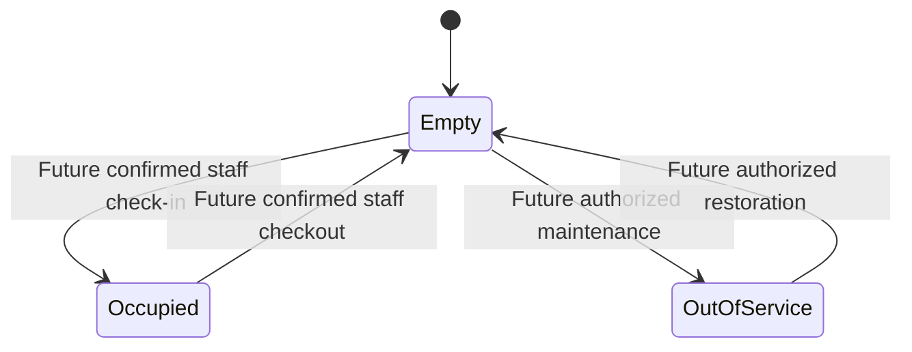

# Software design concepts applied to this project

This guide covers concepts relevant to the current code and required parking
design. It is not an exhaustive textbook or a claim that future safeguards exist.
See [architecture](ARCHITECTURE.md) and [execution diagrams](SEQUENCE_DIAGRAMS.md).

| Concept | Meaning here | Current implementation / next work |
| --- | --- | --- |
| Separation of concerns | Rendering, HTTP, persistence and business policy have distinct responsibilities | Frontend, API entry point, aggregate handler, SQL and tools separated; domain/write/auth modules later |
| Modular monolith | One application can contain focused modules without distributed services | One C++ API process; no microservice dependency |
| Single source of truth | Shared facts live in the database | Real counts query PostgreSQL; browser sample bay is explicitly separate |
| Derived state | Avoid independently stored flags that disagree | Occupancy comes from active sessions, operational status from spaces |
| Relational integrity | Invalid references and combinations are rejected centrally | Foreign keys, composite ownership/zone keys, checks and unique indexes |
| Partial uniqueness | Enforce rules only for active/enabled rows | One enabled vehicle and one active session per user/vehicle/space; historical rows remain |
| State machines | Only valid transitions should be allowed | Session history trigger protects arrival and completed exit; full transition services later |
| Normalization | Canonical identifiers prevent equivalent registrations bypassing uniqueness | Jurisdiction plus normalized registration indexed; normalization service/tests still required |
| Transactions and ACID | Related changes commit together or do not persist | Migration transaction and rollback tests exist; parking/audit/outbox write transactions later |
| Concurrency control | Coordinate competing operations, not just sequential UI requests | DB uniqueness exists; consistent row locks and simultaneous integration tests later |
| Idempotency | Retrying one request should not perform the action twice | Storage schema exists; request hashing, key serialization, results and expiry handling later |
| Optimistic versioning | Detect old events or edits with a resource version | Positive space version and outbox version uniqueness exist; increment/consumer protocol later |
| Transactional outbox | Commit event intent with business changes before delivery | Table/index exist; write service, retry relay and shared delivery later |
| Eventual consistency | Dashboards may lag committed records briefly | Current manual snapshots can lag indefinitely; future SSE lag must be measured and visible |
| Least privilege | Users only access necessary operations and records | Current public API exposes aggregates; authenticated role/location enforcement and separate DB roles later |
| Privacy by projection | Remove private fields before sending a response | Aggregate SQL does not join users/vehicles; staff/driver projections later |
| Authentication vs authorization | Identity is different from permission for a location/object | Neither protected workflow exists yet; both must run server-side |
| Defense in depth | UI checks complement, never replace, server and DB checks | Browser response validation plus schema constraints; write validation/policy/security controls later |
| Safe rendering | Untrusted strings must be rendered as text | DOM textContent/createElement; no HTML insertion or token localStorage |
| Contracts | Consumers depend on a defined request/response shape | OpenAPI for three endpoints, response key/count assertions; full schema contract automation later |
| Bounded work | Limits prevent indefinite requests and resource growth | DB timeout/pool, request-body limit, 100-location bound and browser timeout; pagination/abuse controls later |
| Failure transparency | Distinguish no data, old data and unavailable data | Loading/empty/disconnected/stale states; no false realtime label |
| Accessibility | Operable controls and information beyond color | Labels, keyboard focus, text status, skip link, reduced motion and responsive layout; full audit pending |
| Dependency management | Reproducible inputs make updates reviewable | Lockfile, source commit/image/package pins; ongoing vulnerability review remains necessary |
| Infrastructure as code | Local dependencies are declared rather than manually remembered | Compose, Dockerfile, migration and seed scripts; production infrastructure later |
| Configuration and secrets | Environment-specific credentials stay outside source | Placeholder .env.example, ignored local .env; production secret manager later |
| Observability | Health, logs and metrics explain system behavior | Liveness/readiness and minimal framework logs; redacted structured logs, tracing/metrics/alerts later |
| Testing pyramid | Combine cheap checks with realistic integration evidence | Static tests, TS/build, running API, SQL constraints, launcher regressions; parking E2E/auth/load later |
| Test isolation | Test data should not become unexplained user records | SQL fixtures roll back; persistent seed creates only synthetic spaces/location |
| Migration discipline | Evolve schemas deliberately and track versions | Advisory lock and version ledger for migration 001; rollout compatibility and recovery procedures later |
| Auditability | Preserve who changed what and the historical record | Snapshot/history trigger and audit schema; audited application writes/read/export policies later |
| Tenant isolation | Independent operators cannot access each other's records | Not implemented; current scope is one operator, multi-location |

## State and capacity rules

This describes future services. The database stores sessions and operational
status separately, not this combined state label. Occupied-to-maintenance and
vehicle replacement during an active session must be rejected by those services.

For each location: `operational capacity = available + occupied`; total physical
spaces include out-of-service spaces. Occupancy percentage uses operational
capacity and handles zero capacity. Current seed: six physical spaces, five
operational, five available, zero occupied, one out of service.

## Important tradeoffs

- Plain TypeScript avoids framework overhead now; larger authenticated pages may
  justify a routing/component library after assessing actual needs.
- C++ fulfills the owner's backend choice but needs a compiler/dependency build
  toolchain. Containers simplify local setup; they do not replace security review.
- Database constraints protect all writers, but cannot alone implement permission,
  request identity, physical reconciliation or every cross-table state transition.
- Snapshots keep phase 2 simple; a successful response says when data was read,
  not that the browser remains connected or the physical car was observed.
- Pinning narrows build drift but requires maintenance and does not guarantee
  byte-identical output or absence of vulnerabilities.
- Non-root API container execution reduces process privileges; local database
  credentials are still development credentials, not a production role design.

## Future implementation discipline

Separate validation, session/policy, domain transactions, repositories and event
delivery as protected workflows are added. Prefer explicit interfaces where there
is a genuine boundary; avoid speculative abstractions. Do not trust actor IDs from
request bodies. Use parameterized SQL for inputs, safe conflicts, request IDs,
sanitized audit changes and confirmed server results in the UI.

Release evidence must include concurrency/authorization/realtime recovery tests,
session/CSRF checks, security review, dependency scans, accessible mobile flows,
agreed load measurements, restore drill and operator acceptance. None are implied
by a passing frontend build or by the presence of schema tables.
